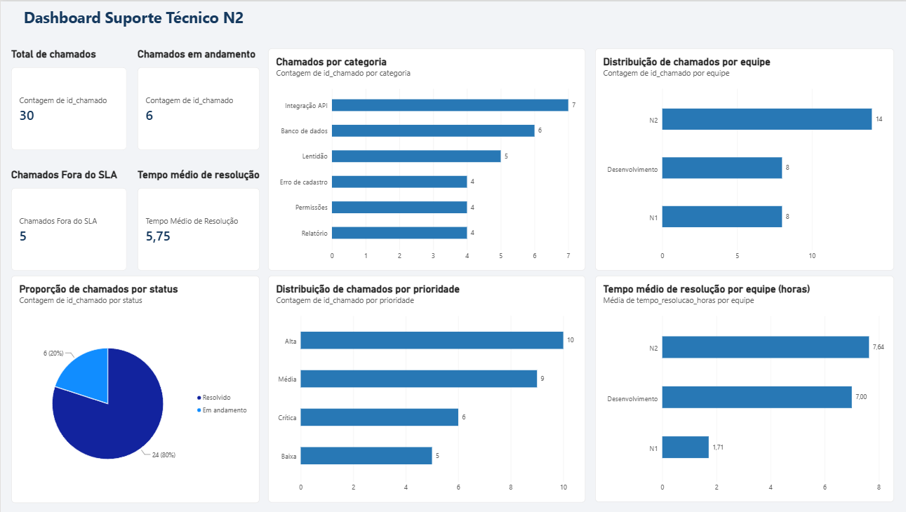

# Dashboard de Suporte Técnico N2

## Sobre o projeto

Projeto de análise de dados desenvolvido no Microsoft Power BI para acompanhar indicadores de chamados de suporte técnico N2.

O dashboard apresenta informações sobre volume de atendimentos, prioridades, cumprimento de SLA e tempo de resolução, com o objetivo de identificar padrões e apoiar decisões operacionais.

## Indicadores e análises

* **Total de chamados:** volume total de chamados registrados.
* **Chamados em andamento:** quantidade de tickets ainda não resolvidos.
* **Chamados fora do SLA:** chamados resolvidos cujo tempo de resolução ultrapassou o prazo definido.
* **Tempo médio de resolução:** média do tempo de resolução dos chamados com duração registrada.
* **Chamados por categoria:** distribuição dos chamados por categoria.
* **Chamados por equipe:** distribuição dos tickets entre as equipes.
* **Chamados por prioridade:** volume de chamados por nível de prioridade.
* **Chamados por status:** proporção de chamados conforme sua situação.
* **Tempo médio de resolução por equipe:** comparação do tempo médio entre as equipes.

## Ferramentas utilizadas

* Microsoft Power BI Desktop
* Power Query para preparação e transformação dos dados
* DAX para criação de medidas e indicadores
* CSV como fonte de dados

## Dados

O projeto utiliza uma base fictícia de chamados, criada exclusivamente para fins de estudo e demonstração. Os dados não representam clientes ou incidentes reais.

## Estrutura do projeto

* `dados/chamados.csv` — base de dados utilizada.
* `imagens/dashboard-suporte-n2.png` — imagem do dashboard.
* `Dashboard-Suporte-N2.pbix` — arquivo editável do Power BI.

## Aprendizados

Este projeto permitiu praticar preparação de dados, criação de medidas com DAX, construção de indicadores e visualização de informações relacionadas à operação de suporte técnico.

---

Projeto desenvolvido para fins de aprendizado e portfólio profissional.
